## 📊 Projects

- 🎧 **Spotify Trend Analysis:** [github.com/AjeySuthan/spotify-hit-analysis](https://github.com/AjeySuthan/spotify-hit-analysis)
- 🕵️ **Deep Fake Guard and Video Detection:** [github.com/AjeySuthan/REPO-NAME](https://github.com/AjeySuthan/REPO-NAME)
- 🚗 **Bluetooth Smart Car:** [github.com/AjeySuthan/REPO-NAME](https://github.com/AjeySuthan/REPO-NAME)

## 🛠️ Tech Stack

## 🎓 Certifications

- SQL Certified Training, QSpiders
- Introduction to Data Engineering and Big Data
- Privacy and Security in Online Social Media, NPTEL
- Design & Implementation of Human-Computer Interfaces, NPTEL

## 📫 Contact

*Open to Data Analyst opportunities.*
